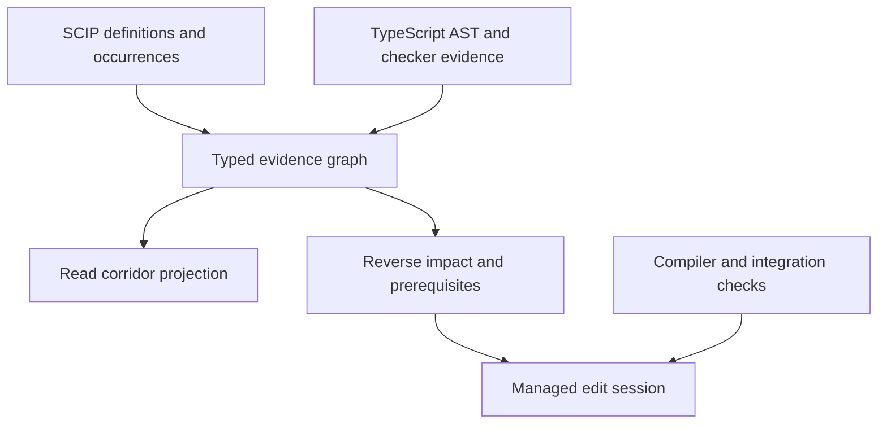

# Semantic architecture

## Workspace responsibilities

| Component | Owns | Main dependency direction |
| --- | --- | --- |
| flowrail-core | Graph types, stable IDs, index-independent slicing, ordering, impact sets, session rules and contract diffs over normalized input | Never imports a host, CLI or language parser |
| flowrail-ts-bridge | SCIP decode, project mapping, AST enrichment, signature extraction and typed diagnostic adapter | Depends on core types and compiler/index artifacts |
| flowrail-cli | Arguments, local configuration, invocation, rendering and process exits | Calls bridge and core, with MCP bootstrapping at entry |
| flowrail-mcp | JSON-RPC/stdin/out tool handlers, validation, workspace ownership and session I/O | Shares core semantics and bridge verification with CLI |
| fixtures/ecommerce-trap | Reference TypeScript project, independent expected results and verification commands | Tests the public workflow |

Use petgraph for graph primitives, SCIP/protobuf for symbol evidence, and OXC for TypeScript AST spans and lexical syntax. Use TypeScript's checker for semantic questions the index or syntax alone cannot establish, through a bounded worker or a compiler run. Keep symbol relationships and graph operations free of network, LLM and vector retrieval dependencies. Start with an in-memory graph and atomic local artifacts. Persistence alternatives and their triggers are in [decisions](07-risks-and-decisions.md).

## Snapshot and indexing (FR-01, FR-02)

1. Resolve workspace, project config, relative paths, dependency lockfile and supported tool versions. A snapshot covers the working-tree bytes, including accepted uncommitted files. Bind source manifest, graph schema, parser/indexer versions and analysis options to a digest. A Git commit alone does not identify dirty input.
2. Import or generate the SCIP index for the selected project. Validate project metadata, document encodings, bounded payload size, paths and offsets. Record skipped files, unresolved dependencies, source/hash mismatches, compiler errors and out-of-scope projects. An imported index with unverifiable provenance carries a coverage warning and cannot certify mutation.
3. Decode definitions and occurrence roles before joining references. Namespace local IDs by document/project. Preserve package, version and descriptors for global SCIP IDs. Store human display aliases such as path plus qualified name as lookups. Ambiguous matches return candidates. Re-exports resolve to a canonical symbol with separate export evidence.
4. Convert ranges from the producing document's encoding to UTF-8 byte spans with half-open boundaries. Accept dialect fields supported by the pinned indexer. Coordinate conversions check Unicode, CRLF and malformed input. Derive one-based inclusive line ranges for public output. AST declaration spans define source windows. A reference occurrence's range supplies its own evidence anchor.
5. Join occurrences to the enclosing callable, type or module and classify the syntax. A resolved expression proven to be the callee yields a call edge. Type-position use, import, implementation, property access and write evidence remain distinct. Unresolved scope or a missing target yields a diagnostic and an unknown boundary; avoid joining unrelated symbols by name.
6. Publish graph and manifest together as a snapshot. On open/inspect/edit/verify, revalidate the relevant snapshot identity. For M1 use a clean full rebuild where a refresh is required. Keep the last valid graph as historical evidence during broken edits. Label its age and refresh semantic claims once compilation succeeds.

### Evidence graph

| Item | Fields and invariants |
| --- | --- |
| Symbol | Stable ID, display alias, canonical relative file, declaration byte and line spans, project, role, exported surface reference, effects/unknowns, provenance. Never serialize petgraph NodeIndex as a public identifier. |
| Relation | Dependent/source ID, dependency/target ID, kind, evidence spans, provenance and resolution status. Examples: call, type reference, contract production, implementation, property use, import/re-export, value reference, write, external boundary. Parallel sites are retained and identical evidence is deduplicated. |
| Coverage | Selected tsconfig scopes, indexed and skipped file counts, skipped paths with reasons, incomplete relation count, truncated answer flag. |
| Read result | Entry anchor, grouped steps, typed edges, visible contracts, boundary candidates, hidden symbol reasons, limits and coverage. |
| Mutation result | Entry and target, prerequisites and stable execution order, gate roles (edit or review), external affected-symbol set with sites, change obligations in sessions. |
| Snapshot identity | Bind config, sources, project scope, index and tool metadata. Keep volatile absolute paths, wall clock and host identity out of canonical plan equality. |

Roles are EntryGate, ContractDefinition, BusinessLogic, DataRepository, ExternalBoundary, UtilityNoise and Unknown. A role comes from syntax/evidence or explicit configuration. Naming can rank discovery candidates; it cannot prove that a method is registered as an HTTP endpoint. M1 resolves explicit symbols. Pilot discovery adds opt-in adapters with reason and provenance. Potential virtual targets remain marked candidate; include confirmed implementations only when evidence supports the relation.

## Read slice (FR-03, FR-04)

1. Start from an explicit entry, traverse supported call and boundary relations and attach contracts as contextual references. Apply depth and node budgets with explicit truncation. Include multiple outcomes such as early return, persistence, external request or output where there is evidence.
2. Traverse the full supported semantic graph before projecting the context view. Apply suppression per symbol. Hide positively identified telemetry or presentation noise where it has no task-relevant effect. Preserve targets, contracts, boundary and domain-state effects, articulation nodes and transit paths. Use fan-in to rank candidates. Directory prefixes can suggest a review, never establish safety. Provide reason codes and a way to request details.
3. Compute strongly connected components on the relevant typed subgraph. Show recursive groups explicitly. Use deterministic ordering of groups for navigation and stable symbol IDs to break ties. A static slice cannot establish which branches ran or the precise execution sequence between siblings.
4. Keep hidden nodes and their evidence reachable in the base graph. A view preference must not shrink blast-radius search or alter validation scope. A budget hit is visible as incomplete coverage.

## Mutation plan (FR-05, FR-06)

1. Record the corridor boundary from semantic read reachability and associated contracts, before presentation suppression. Resolve the target and report how it relates to the entry. If unrelated, require a corrected entry or an explicit target-only workflow in a future interface.
2. Traverse typed incoming dependencies from the target across the indexed scope. Retain path and occurrence evidence. Distinguish direct uses, transitive consumers via a producer or containing contract, imports without behavioral evidence and unresolved relationships. Compute out-of-corridor dependents from original membership.
3. Build an induced subgraph for actionable candidates. Keep business relations stored as dependent → dependency, then orient prerequisites as prerequisite → dependent for scheduling. Use SCC condensation and Kahn-style stable topological order. A group genuinely requiring coordinated changes is marked as an atomic group or a blocked review item until the client supports that edit scope. Distance can help explain proximity. It cannot remove prerequisite edges. For independent gates, use a documented role priority and canonical ID for repeatability.
4. Count unique dependent symbols separately from occurrence count and affected file count. Include precise sites and confidence. Narrow an impact report only by documented analysis scope or more specific evidence. An existing reference means possible impact. Confirm breakage with concrete diagnostics or a targeted behavioral check. Classify a gap as unresolved.
5. Represent the entry and shapes such as unchanged wrappers as review gates where no edit is required. Re-plan on confirmed new obligations with stable gate IDs, versioned plan revision and deduplication; honor prerequisites and preserve verified history. Adding everything at the tail is allowed only if it respects those constraints.

### Runtime traces

A later opt-in trace adapter may attach runtime evidence from a named integration test or sampled workload. Store test identity, snapshot, environment and span provenance. Observed spans cover the instrumentation and workload that produced them. Missing spans leave a gap. Runtime observations supplement static data and cannot remove static consumers or certify coverage of unexecuted paths.
